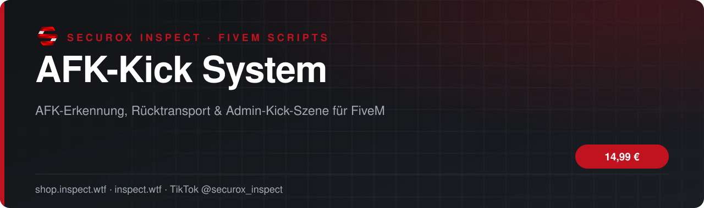
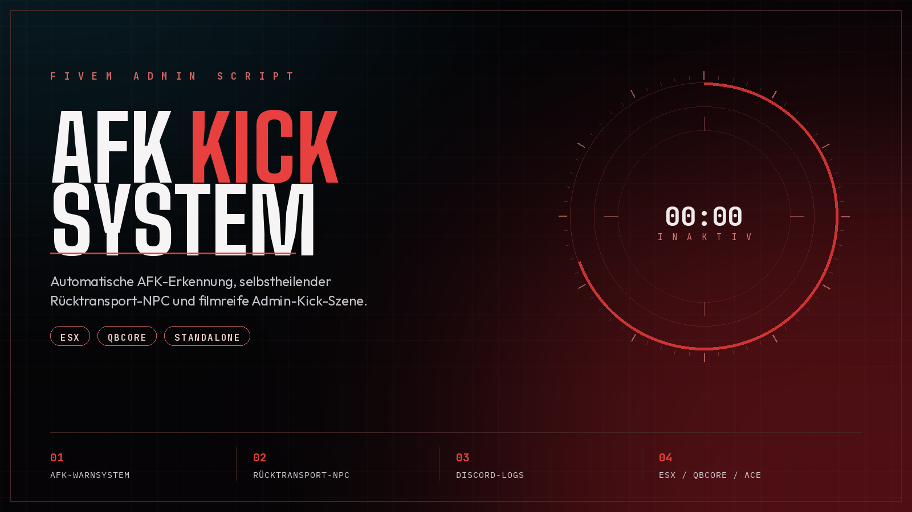

<!-- inspect-showcase: automatisch erzeugt, Änderungen bitte im Shop vornehmen -->

<h3>Automatische AFK-Erkennung mit Warnsystem, AFK-Zone samt Rücktransport-NPC und filmreifer Admin-Kick-Szene - volle ESX-/QBCore-Unterstützung.</h3>

  
  
  
  
  

  
  
  

 

 

## Das Wichtigste auf einen Blick

<table>
  <tr>
    <td width="50%" valign="top">✔&nbsp; <b>Automatische AFK-Erkennung (Bewegung, Heading, konfigurierbare Toleranzwerte)</b></td>
    <td width="50%" valign="top">✔&nbsp; <b>Ignoriert optional Spieler in Fahrzeugen, im Pause-Menü, im Tod-Status oder in Animationen/Szenarien</b></td>
  </tr>
  <tr>
    <td width="50%" valign="top">✔&nbsp; <b>Frei definierbare Safe Zones, in denen die Überwachung nicht greift</b></td>
    <td width="50%" valign="top">✔&nbsp; <b>Discord-ID-Ausnahmeliste für Team-/VIP-Mitglieder</b></td>
  </tr>
</table>

## Überblick

AFK-Kick System erkennt automatisch inaktive Spieler anhand von Bewegung, Blickrichtung und frei konfigurierbaren Toleranzwerten. Betroffene Spieler werden zunächst zweistufig gewarnt - per Zufallstasten-Check, Bildschirmflackern und optionaler Sirene - bevor sie bei fortgesetzter Inaktivität automatisch in eine dedizierte AFK-Zone teleportiert werden. Dort können sie sich über einen robusten, selbstheilenden Rücktransport-NPC per Tastendruck an ihre letzte Position zurückbringen lassen, gespeichert persistent pro Spieler-Identifier. Zusätzlich stehen Admins zwei Befehle zur Verfügung: eine sofortige manuelle AFK-Teleportation sowie eine dramatische Entführungs-Szene mit Wachmann und Fahrzeug, nach der der Spieler automatisch vom Server entfernt wird. Durch die integrierte Framework-Bridge läuft das Skript automatisch mit ESX oder QBCore/QBox - konfigurierbar über eine einzige, klar beschriftete Einstellung in der config.lua. Admins verwalten Berechtigungen wahlweise über ACE-Permissions oder Framework-Gruppen, ein optionaler Discord-Webhook protokolliert jede Aktion mit vollständigen Spieler-Identifiern.

## Kompatibilität

| | |
|:--|:--|
| Frameworks | **ESX** · **QBCore** · **Qbox** · **Standalone** |
| Plattform | FiveM (GTA V) |

## Alle weiteren Funktionen

- Zweistufiges Warnsystem mit Zufallstasten-Check gegen Auto-Clicker/Makros
- Visuelles Flackern (gelb/rot) plus optionale Warnsirene über NUI
- AFK-Zone mit interaktivem, selbstheilendem Rücktransport-NPC
- Rückkehrpunkte persistent pro Spieler-Identifier gespeichert, überlebt Neustarts
- Admin-Befehl für manuelle AFK-Teleportation (/kickafk) mit automatischer Rückkehrpunkt-Speicherung
- Admin-Befehl für filmreife Entführungs-Kick-Szene (/kicknew) mit Wachmann, Fahrzeug und synchronisierter Animation
- Saubere Entity-Bereinigung ohne Server-Ghosts (Netzwerkkontrolle, Missionsentity-Flags, Delete-Fallbacks)
- Framework-Bridge für ESX und QBCore/QBox (automatische Erkennung oder fest wählbar)
- Wahlweise ACE-Permissions oder Framework-Gruppen für die Berechtigungsprüfung
- Standalone-fähig mit nativen Fallback-Benachrichtigungen ohne Framework

<b>3 weitere Funktionen anzeigen</b>

- Optionaler Discord-Webhook für alle Aktionen (standardmäßig deaktiviert, eigener Link erforderlich)
- Alle Texte zentral in Config.Locale, vollständig übersetz- und anpassbar
- Alle wichtigen Einstellungen zentral und beschriftet in der config.lua

## Preis

**14,99 €** &nbsp;–&nbsp; einmaliger Kaufpreis · Download und Lizenz im Kundenkonto

Sichere Zahlung mit PayPal oder Kreditkarte · Rechnung als PDF · Support auf Deutsch

## So einfach geht's

1. **Im Shop kaufen** – sicher bezahlen mit PayPal oder Kreditkarte.
2. **Sofort loslegen** – Download und Lizenz stehen direkt nach Zahlungseingang in deinem Kundenkonto bereit, die Rechnung erhältst du als PDF.
3. **Einrichten** – bei Fragen hilft dir unser Support im Discord weiter.

## Warum INSPECT?

<table>
  <tr>
    <td width="50%" valign="top"><b>🇩🇪 Entwickelt in Deutschland</b> Konzeption, Entwicklung und Support aus einer Hand.</td>
    <td width="50%" valign="top"><b>💬 Persönlicher Support</b> Schnelle Hilfe auf Deutsch im INSPECT Discord.</td>
  </tr>
  <tr>
    <td width="50%" valign="top"><b>🔒 Sichere Zahlung</b> PayPal oder Kreditkarte, Rechnung automatisch als PDF.</td>
    <td width="50%" valign="top"><b>⚡ Sofort verfügbar</b> Download und Lizenz direkt nach der Zahlung im Kundenkonto.</td>
  </tr>
</table>

## Häufige Fragen

<b>Wie erhalte ich das Produkt?</b>

 

Nach bestätigter Zahlung stehen Download und Lizenz in deinem Kundenkonto bereit. Die Rechnung erhältst du als PDF.

<b>Welche Frameworks werden unterstützt?</b>

 

ESX, QBCore, Qbox, Standalone.

<b>Bekomme ich Hilfe bei der Einrichtung?</b>

 

Ja – unser Support hilft dir im [INSPECT Discord](https://discord.gg/inspect) persönlich und auf Deutsch.

<b>Wo kaufe ich offiziell?</b>

 

Ausschließlich im INSPECT Shop unter [shop.inspect.wtf](https://shop.inspect.wtf). Angebote von Dritten stammen nicht von uns.

## Kontakt

| | |
|:--|:--|
| 🛒 Shop | [shop.inspect.wtf](https://shop.inspect.wtf) |
| 🌐 Website | [inspect.wtf](https://inspect.wtf) |
| 💬 Discord | [discord.gg/inspect](https://discord.gg/inspect) |
| 🎬 TikTok | [@securox_inspect](https://www.tiktok.com/@securox_inspect) |
| ✉️ E-Mail | [info@inspect.wtf](mailto:info@inspect.wtf) |

---

<b>SecuroX Inspect</b> · Offizielle Produktpräsentation · Dieses Repository enthält keinen Quellcode und keine Produktdateien. 
Kauf und Lizenzen ausschließlich über <a href="https://shop.inspect.wtf">shop.inspect.wtf</a> · Inhalte werden automatisch aus dem Shop aktualisiert.

